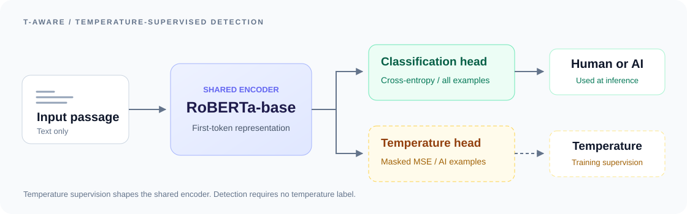

<div align="center">

# T-Aware
### Temperature-Supervised Learning for Robust AI-Text Detection

**Learning to detect AI text through generation-temperature supervision.**

[](https://github.com/twzydn20000928/T-Aware/actions/workflows/tests.yml)
[](https://www.python.org/)
[](https://pytorch.org/)

[Overview](#overview) · [Installation](#installation) · [Quick Start](#quick-start) · [Data](#data) · [Training](#training) · [Evaluation](#evaluation) · [Citation](#citation)

</div>

## Overview

T-Aware is a RoBERTa-based detector for distinguishing human-written and AI-generated text under changes in generation temperature and paraphrasing. A shared encoder learns two tasks: source classification and generation-temperature regression. Temperature supervision is applied only to AI examples; detection at inference requires **text only**.

<p align="center">
  
</p>

- **A simple multi-task model.** One encoder, two linear heads, and a masked auxiliary loss.
- **Temperature-controlled training.** Temp-HC3 covers three generator families and 13 temperature settings.
- **Robustness evaluation.** Evaluation configurations cover DIPPER, Min-P, TempParaphraser, recursive paraphrasing, generator transfer, and domain transfer.
- **A complete experiment workflow.** Train, select checkpoints on validation data, evaluate, and export metrics and predictions as JSON.

The training objective is

$$
\mathcal{L} = \mathcal{L}_{\mathrm{CE}} + \lambda\,\mathcal{L}_{\mathrm{MSE}}^{\mathrm{AI}},
$$

where classification uses all examples and temperature regression uses only AI examples with temperature labels. The default configuration uses raw temperature targets and $\lambda=10$.

### Robustness results

AI recall (%) on the HC3 benchmark, from the reference checkpoint evaluations:

| Condition | Classification only ($\lambda=0$) | T-Aware ($\lambda=10$) |
| :--- | ---: | ---: |
| No attack | 98.85 | **99.69** |
| DIPPER | 83.63 | **95.10** |
| Min-P | 99.17 | **100.00** |
| TempParaphraser | 78.33 | **83.54** |
| Recursive paraphrasing | 81.98 | **96.67** |

The no-attack and paraphrasing conditions use HC3 ChatGPT text; Min-P uses Mistral-generated text. Human recall for these reference evaluations is 98.02% for classification only and 96.35% for T-Aware. The evaluation commands below report both classes, accuracy, and F1.

## Installation

Use Python 3.9 or later and install a PyTorch build compatible with your hardware. GPU execution is recommended for training and benchmark evaluation.

```bash
git clone https://github.com/twzydn20000928/T-Aware.git
cd T-Aware
python -m pip install -e .
```

Check the installation without downloading a model or dataset:

```bash
python scripts/run.py smoke
```

Optional dependencies can be installed by task:

```bash
python -m pip install -e '.[analysis]'     # probes and plots
python -m pip install -e '.[generation]'   # temperature-controlled generation
python -m pip install -e '.[quality]'      # BERTScore and perplexity
```

## Quick Start

### Detect a passage

With a trained checkpoint, run:

```bash
python examples/detect.py \
  --checkpoint /path/to/checkpoint/model.pt \
  --model-config /path/to/checkpoint \
  --tokenizer roberta-base \
  --text "The passage you want to classify." \
  --device cpu
```

The command returns a `human` or `ai` label and the softmax probability assigned to the AI class. For a checkpoint from this repository's training command, the tokenizer is saved in the run's `tokenizer/` directory. See [checkpoint usage](docs/checkpoints.md) for pretrained-base configuration, local model caches, and supported checkpoint files.

### Run an experiment

Point `T_AWARE_DATA_ROOT` to a directory containing the datasets described below:

```bash
export T_AWARE_DATA_ROOT=/path/to/t-aware-data

python scripts/run.py train \
  --config configs/train.json \
  --device cuda \
  --output outputs/t-aware
```

Training writes the chosen checkpoint, configuration, tokenizer, and validation history. The next sections describe data preparation and evaluation.

## Data

**Availability:** this repository distributes the implementation. Temp-HC3 data and trained detector weights are not currently hosted for download here. Training requires prepared JSONL data; inference requires a trained checkpoint. You can run the offline installation check without either asset.

Temp-HC3 contains **418,110 records** across Llama-3, Mistral, and Gemma-2, with 13 AI generation temperatures:

```text
0.2, 0.4, 0.6, 0.8, 1.0, 1.2, 1.4, 1.6, 1.8, 2.0, 2.5, 3.0, 3.5
```

| Split, per generator | Source groups | Human records | AI records |
| :--- | ---: | ---: | ---: |
| Train | 8,000 | 8,000 | 104,000 |
| Validation | 975 | 975 | 12,675 |
| Test | 980 | 980 | 12,740 |

Human answers are repeated across generator partitions. Keep datasets and model weights outside the source checkout:

```text
t-aware-data/
├── dataset/
│   ├── dataset.llama3.train.jsonl
│   ├── dataset.llama3.val.clean.jsonl
│   ├── dataset.llama3.test.clean.jsonl
│   └── ...
├── test_data/
│   ├── dataset.tp.hc3.val.jsonl
│   ├── dataset.tp.hc3.jsonl
│   ├── dataset.dipper.hc3.jsonl
│   └── ...
└── saved_models_epoch50/                 # reference checkpoint layout
    ├── best_defense_model_FINAL_TESTED.pt
    └── model_lambda_0.0_best.pt
```

Read [Data preparation](docs/data.md) for JSONL examples, source grouping, attack datasets, and generation commands. All paths in experiment configurations are resolved relative to `--data-root` or `T_AWARE_DATA_ROOT`.

## Training

The default configuration trains on Llama-3 data using RoBERTa-base, AdamW, learning rate $2\times10^{-5}$, batch size 128, maximum length 128, and up to 50 epochs. Human examples are repeated to balance the training classes. Early stopping uses TempParaphraser validation AI recall with patience 15; test data is evaluated separately.

| Configuration | Purpose |
| :--- | :--- |
| [`train.json`](configs/train.json) | T-Aware with $\lambda=10$ |
| [`train_classification_only.json`](configs/train_classification_only.json) | Classification-only ablation with $\lambda=0$ |
| [`train_lambda_sweep.json`](configs/train_lambda_sweep.json) | Sweep $\lambda\in\{0,2,4,6,8,10,12,14\}$ |
| [`train_random_temperature.json`](configs/train_random_temperature.json) | Random-temperature auxiliary-task control |
| [`train_normalized_temperature.json`](configs/train_normalized_temperature.json) | Optional normalized-target experiment |

The run directory contains:

```text
outputs/t-aware/
├── manifest.json          # settings, input fingerprints, and environment
├── selection.json         # validation-selected checkpoint
├── tokenizer/
└── lambda_10/
    ├── model.pt
    ├── config.json
    ├── run.json
    └── history.json
```

See [Experiment guide](docs/reproduction.md) for ablations, configuration options, and checkpoint selection.

## Evaluation

### Evaluate a trained model

```bash
python scripts/run.py evaluate \
  --data "$T_AWARE_DATA_ROOT/test_data/dataset.tp.hc3.jsonl" \
  --checkpoint outputs/t-aware/lambda_10/model.pt \
  --model-config outputs/t-aware/lambda_10 \
  --tokenizer outputs/t-aware/tokenizer \
  --device cuda \
  --empty-text skip \
  --output outputs/tp-evaluation.json
```

For a lambda sweep, use the checkpoint named in `selection.json`. Evaluation exports accuracy, AI recall, human recall, AI-positive F1, macro F1, the confusion matrix, and per-example predictions.

### Run benchmark suites

The supplied benchmark configurations use the reference checkpoint layout shown above:

```bash
# HC3 attacks and SQuAD/XSum domain transfer
python scripts/run.py benchmark \
  --config configs/evaluate_main.json \
  --device cuda \
  --output outputs/main.json

# Llama-3, Mistral, and Gemma-2 generator transfer
python scripts/run.py benchmark \
  --config configs/evaluate_cross_generator.json \
  --device cuda \
  --output outputs/cross-generator.json
```

To evaluate newly trained models in a suite, set each model's `checkpoint`, `model_config`, and `tokenizer` in a copy of the benchmark JSON. [Experiment guide](docs/reproduction.md) includes an example. Lower `batch_size` in the configuration for smaller devices.

## Analysis and Baselines

| Task | Command | Details |
| :--- | :--- | :--- |
| Dataset validation | `check-data` | Schema, counts, class balance, and source overlap |
| Temperature-controlled generation | `generate` | 13 temperatures, human anchors, and resumable output |
| Token statistics | `statistics` | Predictive entropy, mean surprisal, and surprisal variance |
| Representation probing | `probe` | Ridge regression with a source-group holdout |
| Rewrite quality | `quality` | BERTScore and GPT-2 perplexity |
| External detectors | `baseline` | SuperAnnotate, Fast-DetectGPT, Binoculars, and LLM judges |

See the [Experiment guide](docs/reproduction.md) and [Baseline guide](docs/baselines.md) for commands and optional dependencies. Use `python scripts/run.py <command> --help` for all options.

## Repository Structure

```text
├── configs/               # training, ablation, and benchmark configurations
├── docs/                  # data, checkpoints, and experiment guides
├── examples/detect.py      # single-passage inference
├── scripts/run.py          # unified experiment entry point
├── scripts/data/           # standalone data-generation utilities
├── src/t_aware/            # model, data loading, training, metrics, and analysis
├── tests/                  # offline CPU tests
└── third_party/Binoculars/ # attributed baseline implementation
```

For development, run `python -m unittest discover -s tests -v`. The offline tests cover data validation, masked regression, checkpoint loading, metrics, and a small train/evaluate workflow.

## Citation

If you use this implementation, please cite the T-Aware paper. The following entry identifies this code repository:

```bibtex
@software{taware,
  title = {T-Aware: Temperature-Supervised Learning for Robust AI-Text Detection},
  author = {{T-Aware Authors}},
  year = {2026},
  url = {https://github.com/twzydn20000928/T-Aware}
}
```

## Acknowledgements

This implementation builds on PyTorch, Hugging Face Transformers, and RoBERTa. The Binoculars reference implementation is included under its BSD 3-Clause license. See [NOTICE](NOTICE.md) for attribution and distribution information.

For questions and bug reports, please [open an issue](https://github.com/twzydn20000928/T-Aware/issues).
